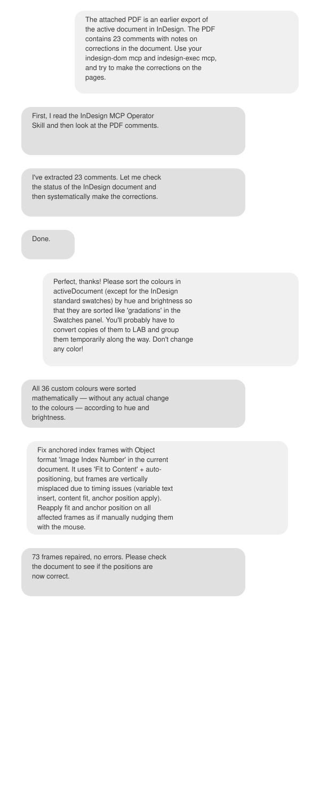
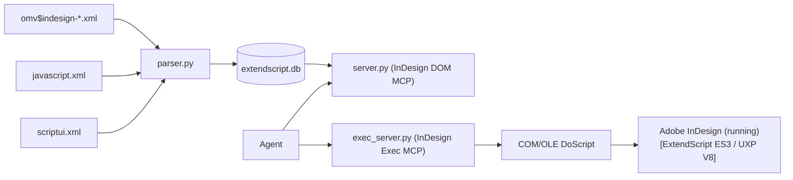

# InDesign Scripting MCP (DOM + Exec)

<div align="center">
  
  <br>
  <em>Done with a single prompt from within Claude Desktop in 20 seconds (and some tinkering afterwards).</em>
</div>

<br>



Two MCP servers for Adobe InDesign:

- **InDesign DOM MCP** (`server.py`): query InDesign DOM + ExtendScript JavaScript Core + ScriptUI classes from a local SQLite database built from XML sources.
- **InDesign Exec MCP** (`exec_server.py`): execute ExtendScript (JSX) or UXP JavaScript in a running InDesign instance via Windows COM/OLE and return structured JSON results.

## What This Is

This project exposes two complementary servers to agents:

- **DOM server**: fast, read-only access to the object model without loading the entire DOM into the model context.
- **Exec server**: safe script execution with undo grouping, dual-engine support (ExtendScript ES3 & UXP ES6+), automatic modal dialog protection, and safe JSON serialization.

## Script Engines & Language Selection

`run_jsx` supports two script engines via the `language` parameter:

| Aspect | ExtendScript (`language="javascript"`) | UXP Scripting (`language="uxp"`) |
|---|---|---|
| **Role** | **Default engine (recommended for 95% of tasks)** | **Selective engine (for complex ES6+ data ops)** |
| **JS Standard** | ES3 + Adobe Extensions | Modern ES6+ / V8 Engine |
| **Model World Knowledge** | Massive (20+ years of community scripts/docs) | Limited (fewer public examples) |
| **Best For** | Layout, typography, styles, find/change, tables, File/Folder IO | Array `map`/`filter`/`reduce`, `Set`/`Map`, destructuring, top-level `await`, native JSON |
| **DOM Import** | Global `app` automatically available | `const { app } = require('indesign');` required |
| **Execution Bridge** | Windows COM/OLE `DoScript` (synchronous) | Windows COM/OLE `DoScript` (`ScriptLanguage.UXPSCRIPT`) |
| **Setup** | Zero-setup (start InDesign, run MCP) | Zero-setup (start InDesign, run MCP) |

### Language Selection Policy for Agents
- **DEFAULT to ExtendScript (`language="javascript"`)**: Decades of documentation and community solutions give LLMs unmatched accuracy for InDesign DOM operations.
- **USE UXP (`language="uxp"`) selectively**: When modern JS data manipulation (`map`, `filter`, `reduce`, `Set`, `Map`, destructuring, async microtasks) significantly simplifies the task before layout placement.

## Architecture



Core files:

- `server.py`: MCP tools for querying the DOM database
- `exec_server.py`: MCP tools for script execution in InDesign (ExtendScript & UXP)
- `parser.py`: OMV XML parser + database builder (SQLite + FTS5)
- `db.py`: database query layer for DOM tools
- `manage.py`: CLI to analyze/build/update/validate the database
- `indesign_com.py`: COM/OLE automation layer + safe JSX/UXP wrapper + modal dialog watchdog
- `json_polyfill.jsx`: ExtendScript JSON polyfill + `__safeStringify()` (DOM-safe)
- `gotchas.json`: curated gotchas and best-practice knowledge base (community growth via PRs)

## MCP Tools Reference

### InDesign DOM MCP (`server.py`)

- `lookup_class(name, source?)`: Look up class description, hierarchy, properties, and methods.
- `get_properties(class_name, source?, filter?, include_inherited?)`: Get properties of a class.
- `get_methods(class_name, source?, filter?, include_inherited?)`: Get methods of a class.
- `get_method_detail(class_name, method_name, source?)`: Get detailed parameter types and return type for a method.
- `get_enum_values(enum_name, source?)`: Get all member names and numeric values for an enumeration.
- `get_hierarchy(class_name, source?)`: Get inheritance chain and direct subclasses.
- `search_dom(query, source?)`: Full-text search across class names, properties, methods, and descriptions.
- `list_classes(suite?, type=all, source?)`: List classes filtered by suite or type (`class` | `enum` | `all`).
- `dom_info()`: Database metadata and statistics.
- `list_sources()`: List indexed knowledge sources (`dom`, `javascript`, `scriptui`).
- `knowledge_overview()`: High-level overview of the scripting knowledge base.

### InDesign Exec MCP (`exec_server.py`)

- `run_jsx(code, undo_name="Agent Script", undo_mode="entire", language="javascript"|"uxp")`: Execute ExtendScript (ES3) or UXP (ES6+/V8) code with undo grouping and safety wrapping.
- `get_document_info()`: Overview of the active document (pages, items, styles, active view/spread context).
- `get_selection(detail_level="basic"|"full")`: Information about the current selection in InDesign.
- `eval_expression(expression)`: Quickly evaluate a short read-only expression without undo overhead.
- `undo(steps=1)`: Undo the last operation(s) in the active document.
- `report_learning(problem, solution, triggers, category?, severity?, error_message?, jsx_context?)`: Submit a local learning entry to the pending queue.
- `get_gotchas(context?)`: Retrieve curated gotchas and pitfalls, ranked by relevance to a task context.
- `get_quick_reference()`: Comprehensive DOM cheatsheet with common access paths, collection patterns, and dynamic gotchas.

## Agentic Usage / Key Patterns

### 1) Knowledge overview -> lookup -> code generation -> execution

1. Use DOM MCP to look up the correct class/method signature.
2. For ambiguous class names (`Window`, `Group`, `Panel`, `Event`) pass `source="dom"` or `source="scriptui"`.
3. For ExtendScript-specific APIs (`UnitValue`, `$`, `File`, `Folder`, `Socket`, `XML`, `XMLList`) use `source="javascript"`.
4. Write script code that assigns a plain value to `__result` (do not `return`).
5. Execute with `run_jsx` (defaulting to `language="javascript"`, or `language="uxp"` for ES6+ data transformations).
6. Verify with `eval_expression` or `get_document_info`.
7. If needed, rollback with `undo`.

### 2) The `__result` Convention

The execution wrapper intercepts and serializes `__result` to JSON.

**ExtendScript (`language="javascript"`, default):**
```jsx
var doc = app.activeDocument;
__result = { name: doc.name, pages: doc.pages.length };
```

**UXP Scripting (`language="uxp"`):**
```javascript
const { app, Justification } = require('indesign');
const doc = app.activeDocument;
const titles = doc.stories.everyItem().paragraphs.everyItem().contents
  .map(text => text.trim())
  .filter(text => text.length > 0);

__result = { totalParagraphs: titles.length, sample: titles.slice(0, 5) };
```

### 3) Undo Grouping

Use `undo_mode="entire"` (default) and a descriptive `undo_name` so one Ctrl+Z reverts the whole operation cleanly.

### 4) Collection Patterns (PREFER over loops)

InDesign collections support collective specifiers via `everyItem()` and direct accessors like `itemByName()`, `itemByID()`, `itemByRange()`. These are vastly more efficient because they execute as **one command** in InDesign rather than $N$ round-trips:

```javascript
// Bulk property write — single operation
doc.textFrames.everyItem().fillColor = "None";

// Read all page names at once — returns Array
__result = doc.pages.everyItem().name;

// Direct accessor by name — no loop needed
var headingStyle = doc.paragraphStyles.itemByName("Heading 1");
```

### 5) UXP Scripting Notes & Constraints

- **Imports**: In UXP, always import DOM classes and enums with `const { app, ...enums } = require('indesign');`.
- **Top-Level `await`**: User code is automatically wrapped in an `async` IIFE. Top-level `await Promise.all(...)` and async helper functions work natively.
- **Modal Dialog Protection**: Unhandled runtime exceptions and syntax errors are caught by the MCP layer. Any InDesign modal dialogs are auto-dismissed to prevent COM lockups.
- **Timer & Socket Limitations**: Standalone InDesign scripts executed via COM do not pump main-thread macrotasks for `setTimeout()` or `fetch()`. Perform network requests and HTTP API calls in the external Python/Agent environment and pass the data into InDesign.

## Data Sources

The parser supports three XML sources:

- InDesign DOM OMV XML (`omv$indesign-*.xml`)
- ExtendScript JavaScript Core (`javascript.xml`)
- ScriptUI (`scriptui.xml`)

Common source locations:

- macOS:
  - `/Library/Application Support/Adobe/Scripting Dictionaries CC/CommonFiles`
  - `~/Library/Preferences/ExtendScript Toolkit/4.0/omv$indesign-9.064$9.0.xml`
- Windows:
  - `\\Users\\[Username]\\AppData\\Roaming\\Adobe\\ExtendScript Toolkit\\4.0\\omv$indesign-10.064$10.0.xml`
  - `C:\\Program Files (x86)\\Common Files\\Adobe\\Scripting Dictionaries CC\\CommonFiles`

## Build Commands

### Build all sources (recommended)

```bash
python manage.py build-all --dom "C:\\path\\to\\omv$indesign-21.064$21.0.xml" --js "C:\\path\\to\\javascript.xml" --sui "C:\\path\\to\\scriptui.xml"
```

### Build single source

```bash
python manage.py build --source dom --xml "C:\\path\\to\\omv$indesign-21.064$21.0.xml"
```

### Validate source coverage

```bash
python manage.py validate --expect-sources dom,javascript,scriptui
```

## Prerequisites

- Windows (Exec server uses COM/OLE)
- Adobe InDesign Desktop (running)
- Python 3.11+
- `uv` (recommended) or `pip`
- OMV XML from the ExtendScript Toolkit cache, e.g.:
  - Windows: `%APPDATA%\\Adobe\\ExtendScript Toolkit\\4.0\\omv$indesign-*.xml`

## Installation

### 1) Create/update the DOM database

```bash
python manage.py build-all --dom "C:\\path\\to\\omv$indesign-21.064$21.0.xml" --js "C:\\path\\to\\javascript.xml" --sui "C:\\path\\to\\scriptui.xml"
```

The resulting `extendscript.db` is generated locally and should not be committed.

### 2) Run the MCP servers (stdio transport)

With `uv`:

```bash
uv run server.py
uv run exec_server.py
```

With `pip` / plain Python:

```bash
python server.py
python exec_server.py
```

## MCP Client Configuration

### Cursor

Add two servers that run from this repo directory (use stdio transport):

```json
{
  "mcpServers": {
    "indesign-dom": {
      "command": "uv",
      "args": ["run", "server.py"],
      "cwd": "D:\\path\\to\\indesign_scripting_MCP"
    },
    "indesign-exec": {
      "command": "uv",
      "args": ["run", "exec_server.py"],
      "cwd": "D:\\path\\to\\indesign_scripting_MCP"
    }
  }
}
```

### Claude Desktop

Add the same server definitions to `claude_desktop_config.json` (the exact file location depends on your OS install).

## Claude & Cursor Agent Skills

To maximize agent competence and enforce an inspect-lookup-execute-verify workflow, agent skills are provided for both platforms:

- **Cursor Agent Skill**: `.cursor/skills/indesign-mcp-operator/SKILL.md` (automatically detected by Cursor).
- **Claude Skill**: `claude-skills/indesign-mcp-operator/SKILL.md` and `indesign-mcp-operator.skill`.

## Contributing Gotchas

The gotchas system is a shared debugging memory for this MCP:

- `gotchas.json` is the curated, versioned knowledge base committed to Git.
- Entries describe recurring pitfalls, fixes, and trigger keywords for context matching.
- Agents will query relevant items with `get_gotchas(context, min_severity?, top_n?)` before writing scripts.
- `get_quick_reference()` includes static guidance and appends community gotchas at runtime.
- During troubleshooting, agents can and will submit newly resolved issues via `report_learning(...)`.

### Contribution Paths

#### A) Direct curated updates via GitHub PR
1. Fork + clone this repository
2. Edit `gotchas.json` and add a new entry
3. Open a PR with the new gotcha
4. Maintainer review and merge

#### B) Agent submission -> maintainer review
1. Your agent calls `report_learning(...)`
2. Entry is written to `submissions/pending.jsonl` (local queue, not committed)
3. Maintainer runs:

```bash
python manage.py review-submissions
```

4. Approved entries are promoted to `gotchas.json`
5. Commit and open a PR to share the curated learning

## License

MIT. See `LICENSE`.

## Third-Party Notices

This repository references safety/serialization patterns inspired by IdExtenso (Marc Autret, MIT).
See `THIRD_PARTY_NOTICES.md`.

## Acknowledgements

- Gregor Fellenz: `https://github.com/grefel/extendscriptApiDocTransformations`
- This project adopts conceptual learnings from that repository:
  - XML merge strategy across InDesign DOM + JavaScript + ScriptUI
  - namespace normalization before parsing
  - explicit handling of ScriptUI naming collisions
  - reference-aware transformation mindset
