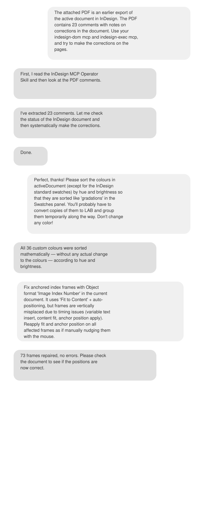

# InDesign Scripting MCP for Windows

**Let Claude or Cursor work directly in Adobe InDesign. Describe the task, the agent writes and runs the script.**

<div align="center">
  
  <br>
  <em>Done with a single prompt from within Claude Desktop in 20 seconds (and some tinkering afterwards).</em>
</div>

<br>



## What You Can Do

Ask in plain language, for example:

- *"Apply the paragraph style 'Heading 2' to every line that starts with a number."*
- *"List all fonts used in this issue and tell me which ones are missing."*
- *"Run preflight and show me every overset text frame with its page."*
- *"Place a caption under every image on pages 12–18."*
- *"Undo what you just did."*

The agent looks up InDesign's scripting API, writes the script, runs it in your open document and checks the result. Every change is a single step in **Edit › Undo**.

## Built for Windows

Many InDesign MCP servers are built Mac-first (UXP plugin or AppleScript) and treat Windows as an add-on. This one is built and used in daily magazine production on Windows:

- **No plugin to install.** It talks to InDesign through the native Windows COM interface. Start InDesign, start the agent, done.
- **One undo step per action.** Each script is grouped into a single, named undo step.
- **Protects your documents.** If a script unexpectedly opens another document (a known InDesign hyperlink pitfall), the agent notices, closes it if safe and warns you.
- **Knows InDesign.** A local database of the complete InDesign scripting API (incl. ExtendScript and ScriptUI) and a growing collection of known pitfalls ("gotchas") keep the agent from guessing.
- **Free-form scripts instead of hundreds of fixed tools.** A small set of tools keeps the agent's context lean; anything InDesign can script is possible.
- **Two script engines.** Classic ExtendScript (default) and modern UXP JavaScript.

## New in November 2026

- **Precise error messages:** script errors point to the exact line of the agent's code; syntax errors are found without running anything. `debug=true` shows the surrounding lines.
- **Change log:** every changing action records which objects were added, removed or edited (`get_change_log`).
- **Typography audit:** fonts with status, sizes and leading, style usage, local overrides, overset text. Read-only, useful for issue sign-off (`typography_audit`).
- **Preflight check:** runs the document's preflight profile and reports the findings per page, and whether the check actually finished (`preflight_document`).
- **Docs check:** `check_docs.py` makes sure the README, docs and agent skills only mention tools that exist.
- **API knowledge from indesignjs.de**, including notes on where UXP behaves differently from ExtendScript.

## Quick Start

### 1. Requirements

- Windows 10/11 with Adobe InDesign (2025 or 2026)
- [Python 3.11+](https://www.python.org/downloads/) and [uv](https://docs.astral.sh/uv/getting-started/installation/)
- Claude Desktop or Cursor

### 2. Download and build the API database

```bash
git clone https://github.com/MoebiusSt/indesign-scripting-mcp.git
cd indesign-scripting-mcp
python manage.py update
```

### 3. Connect your agent

Add both servers to `%APPDATA%\Claude\claude_desktop_config.json` (Claude Desktop) or to the MCP settings in Cursor. Replace the path with your folder:

```json
{
  "mcpServers": {
    "indesign-dom": {
      "command": "uv",
      "args": ["run", "--script", "C:\\path\\to\\indesign-scripting-mcp\\server.py"]
    },
    "indesign-exec": {
      "command": "uv",
      "args": ["run", "--script", "C:\\path\\to\\indesign-scripting-mcp\\exec_server.py"]
    }
  }
}
```

Restart Claude Desktop or Cursor, open a document in InDesign and start asking.

### 4. Optional: install the agent skill

The skill teaches the agent a safe routine (inspect → look up → run → verify → undo if needed):

- **Cursor:** `.cursor/skills/indesign-mcp-operator/SKILL.md` is picked up automatically.
- **Claude:** upload `claude-skills/indesign-mcp-operator/indesign-mcp-operator.skill`.

## Learn More

- [Tool reference](docs/tools.md): all tools of both servers
- [Agent guide](docs/agent-guide.md): script engines, undo, error reporting, change log, best practices
- [Architecture, data sources & build](docs/architecture.md): how the API database is built and updated
- [Contributing gotchas](docs/contributing-gotchas.md): share pitfalls and fixes with other users

## License

MIT. See `LICENSE`.

## Third-Party Notices

Safety and serialization patterns are inspired by IdExtenso (Marc Autret, MIT). See `THIRD_PARTY_NOTICES.md`.

## Acknowledgements

- Gregor Fellenz: the [Adobe ExtendScript API reference](https://www.indesignjs.de/indesignapi/) on indesignjs.de is the data source of the DOM server (descriptive texts by Adobe), and [extendscriptApiDocTransformations](https://github.com/grefel/extendscriptApiDocTransformations) provided conceptual learnings for the former OMV XML pipeline.
- Theunis de Jong (Jongware): the original JavaScript reference this work continues.
- Andrea Cacioppo ([nutriandrea/adobe-indesign-mcp](https://github.com/nutriandrea/adobe-indesign-mcp)): the ideas for line-exact script errors, the read-only typography audit, honest preflight reporting, change tracking and the docs check that only allows existing tool names.
