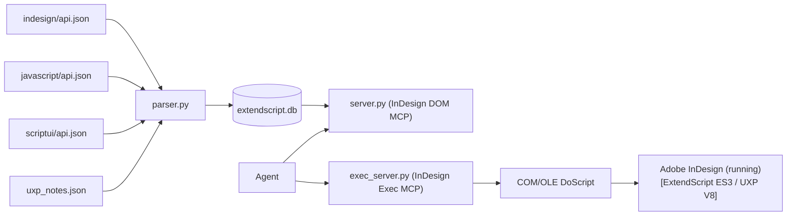

# Architecture, Data Sources & Build

[← Back to README](../README.md)

## Overview



## Core Files

- `server.py`: MCP tools for querying the DOM database
- `exec_server.py`: MCP tools for script execution in InDesign (ExtendScript & UXP)
- `indesign_com.py`: COM/OLE automation layer + safe JSX/UXP wrapper + modal dialog watchdog
- `json_polyfill.jsx`: ExtendScript JSON polyfill + `__safeStringify()` (DOM-safe)
- `parser.py`: api.json fetcher + parser + database builder (SQLite + FTS5), UXP rules, UXP marker scan
- `uxp_notes.json`: hand-curated UXP notes that no rule can derive from api.json
- `db.py`: database query layer for DOM tools
- `manage.py`: CLI to check/fetch/build/update/validate the database and review gotcha submissions
- `gotchas.json`: curated gotchas and best-practice knowledge base
- `check_docs.py`: verifies that README, docs and skills name only registered tools and parameters

## Data Sources

The database is built from the [Adobe ExtendScript API reference](https://www.indesignjs.de/indesignapi/) maintained by Gregor Fellenz (continuation of the Jongware reference by Theunis de Jong). It is generated from Adobe's OMV exports, so the OMV XML files from the ExtendScript Toolkit cache are no longer needed.

| Source key | Upstream file | Content |
|---|---|---|
| `dom` | `indesign/api.json` | InDesign object model (2026: 21.5.1.73) |
| `javascript` | `javascript/api.json` | ExtendScript Core JavaScript (`$`, `File`, `Folder`, `UnitValue`, `XML`, ...) |
| `scriptui` | `scriptui/api.json` | ScriptUI |

What the parser adds on top of api.json:

- **Static methods** of Core JavaScript and ScriptUI (`File.openDialog`, `Folder.selectDialog`, `$.evalFile`, ...): api.json and the `.d.ts` files carry no static flag for methods, so `parser.py` keeps a fixed table (`STATIC_METHODS`). Both libraries are frozen.
- **Reserved names**: upstream escapes `Index` as `Index_`; the parser restores `Index` (the `doc_url` keeps `Index_.md`).
- **UXP runtime data**, mirroring the ExtendScript/UXP toggle on indesignjs.de: rules in `parser.py` (enum `equals()`, no `[]` accessor, async `File`/`Folder`, `File` event handlers) plus `uxp_notes.json` for hand-written cases. `manage.py check-uxp` scans the rendered pages of `indesignapi.zip` and lists every UXP marker that rules and overrides do not cover.
- **Suites** no longer exist upstream; `list_classes` filters by kind instead.

## Build Commands

```bash
python manage.py check       # compare upstream llms.txt (~2 KB) with the database
python manage.py update      # check + fetch api.json + diff + build (use --force to rebuild)
python manage.py fetch       # only download api.json files into sources/indesignjs/
python manage.py build       # only rebuild from the downloaded files
python manage.py check-uxp   # optional: verify UXP coverage against the rendered pages (~19 MB zip)
python manage.py validate --dir sources/indesignjs
python check_docs.py         # docs/skills name only registered tools and parameters
```

`build`/`update` write `extendscript.db` and, if present, the legacy `indesign_dom.db`. The database is written to a temporary file and swapped in at the end, so a running DOM server keeps working during the build. The downloaded files (`sources/`) and the database are generated locally and are not committed.

## Running the Servers Manually (stdio)

```bash
uv run server.py
uv run exec_server.py
```

or with plain Python after `pip install -r requirements.txt`:

```bash
python server.py
python exec_server.py
```
